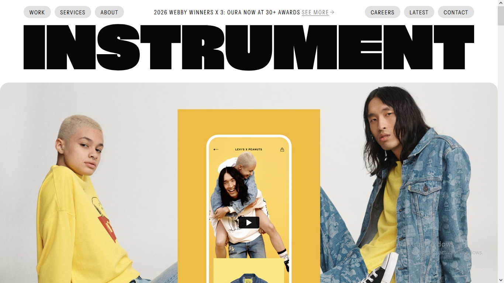
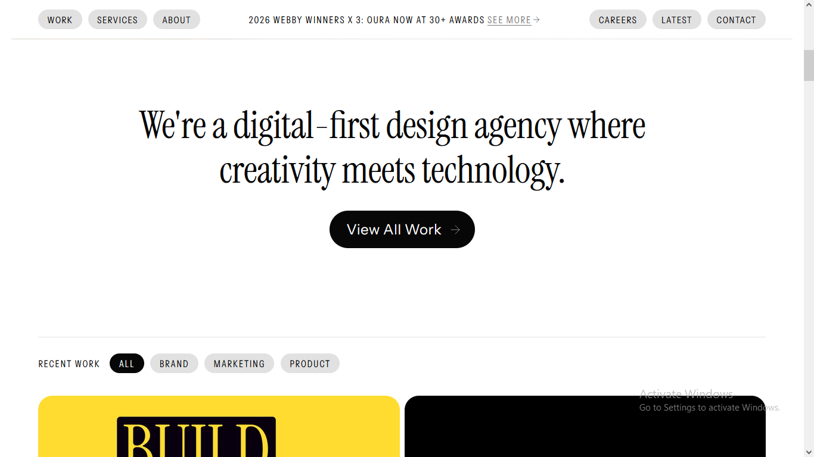
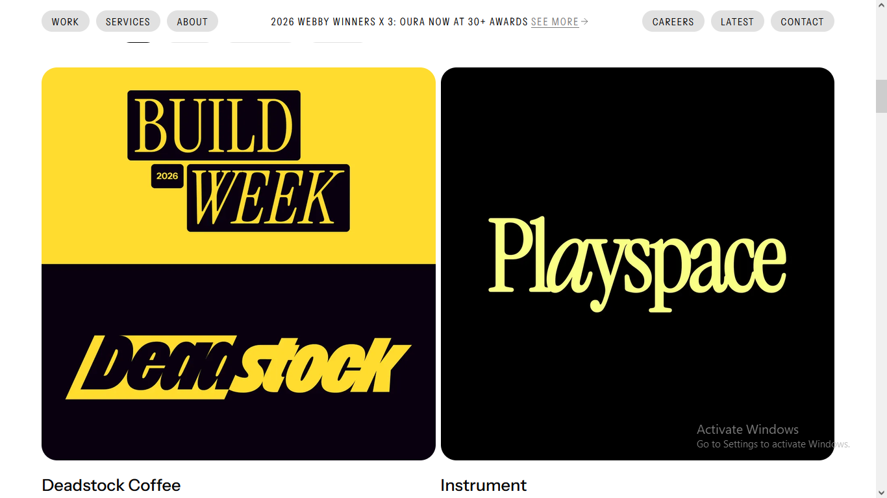

# Instrument-Inspired Creative Agency Website

An independent creative agency website concept inspired by Instrument's editorial visual direction.

## Overview

This project explores expressive typography, modern layouts, navigation, spacing, and visual presentation for a creative agency website.

## Built With

- HTML5
- CSS3
- Google Fonts

## Features

- Editorial typography
- Minimal navigation
- Large visual sections
- Creative agency presentation
- Structured website layouts

## Project Purpose

Created as an independent frontend project to improve my understanding of creative website design and CSS implementation.

## Screenshots

## Live Demo

[View Live Website](https://shezan-ali.github.io/instrument-ui-clone/)

## Disclaimer

This is an independent practice project and is not affiliated with or endorsed by Instrument.
